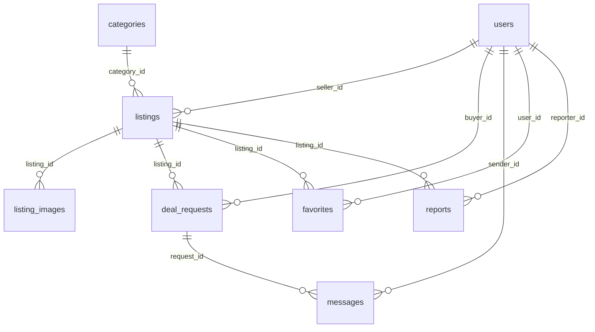

# CampusMarket — студенческая барахолка

FastAPI + PostgreSQL + SQLAlchemy 2 + Alembic. Интерфейс — серверные шаблоны Jinja2 (HTML/CSS/JS), без внешних сервисов.

## Запуск с нуля

```bash
# 1. База данных (нужен Docker). Либо свой PostgreSQL — поправьте DATABASE_URL в .env
docker compose up -d

# 2. Окружение
python -m venv .venv
source .venv/bin/activate          # Windows: .venv\Scripts\activate
pip install -r requirements.txt
cp .env.example .env               # файл .env уже лежит в архиве, можно пропустить

# 3. Миграции и демоданные
alembic upgrade head
python -m app.seed

# 4. Сервер
uvicorn app.main:app --reload
```

Откройте http://127.0.0.1:8000

## Тестовые аккаунты

| Роль | Email | Пароль |
|---|---|---|
| Администратор | admin@campus.test | admin12345 |
| Модератор | mod@campus.test | password123 |
| Участники | anna@campus.test, boris@campus.test, chingiz@campus.test | password123 |

Администратор создаётся только командой `python -m app.seed` (из `ADMIN_EMAIL` / `ADMIN_PASSWORD`). Остальные роли назначает администратор на странице «Пользователи».

## Тесты

```bash
pytest -q
```

Тесты используют SQLite-файл `test_campus.db` (не трогают PostgreSQL). Покрыто: основной сценарий, валидация (цена, 6-е фото, .exe), права (чужая переписка, чужое объявление, роли), запрещённые переходы статусов, второй резерв (сервис + ограничение БД), скрытие модератором.

## Роли и права

- Гость: каталог и карточки.
- Участник: объявления, заявки, переписка, избранное, жалобы.
- Модератор: жалобы, скрытие и возврат объявлений.
- Администратор: всё это + назначение ролей.

Права проверяются на сервере в каждом обработчике.

## Статусы

Объявление: `published → reserved → completed`; `reserved → published` (снять резерв); `published ⇄ archived`; `hidden` — скрыто модератором (возврат: `published`, либо `reserved`, если есть принятая заявка).
Заявка: `pending → accepted → completed`; `pending/accepted → rejected | cancelled`.
Выбор получателя: блокировка строки объявления (`SELECT … FOR UPDATE`) + частичный уникальный индекс `uq_one_accepted_per_listing` — два принятия одновременно не создадут два резерва.

## Маршруты (серверные формы)

| Метод | URL | Доступ |
|---|---|---|
| GET | /listings (q, category, mode, condition, price_min, price_max, sort, page) | все |
| GET | /listings/{id} | все (скрытые — автор и персонал) |
| GET/POST | /listings/new, /listings | участник |
| GET/POST | /listings/{id}/edit (аналог PATCH) | автор |
| POST | /listings/{id}/archive, /restore, /release, /complete | автор |
| POST | /listings/{id}/requests | участник, не автор |
| POST | /requests/{id}/accept, /reject | автор объявления |
| POST | /requests/{id}/cancel | автор заявки |
| GET/POST | /requests/{id}/messages | продавец и заявитель |
| POST | /listings/{id}/favorite; GET /favorites | участник |
| POST | /reports | участник |
| GET | /moderation; POST /moderation/reports/{id}/hide, /dismiss; POST /moderation/listings/{id}/restore | модератор, админ |
| GET/POST | /admin/users, /admin/users/{id}/role | админ |
| GET/POST | /register, /login, /profile, /profile/delete; POST /logout | по ситуации |

Ошибки: 400 — ввод, 401 → редирект на вход, 403 — права, 404 — нет объекта, 409 — конфликт состояния. Страницы ошибок объясняют причину.

## ER-диаграмма



Обоснование отличий от предложенной модели: у `User` добавлены `role`, `is_active` (мягкое удаление — история сделок не ломается); у `Listing` — `hide_reason`, `created_at`, `updated_at`; у `Report` — `status`, `resolved_by_id`. Каскадных удалений нет.

## Ограничения

- Нет CSRF-токенов: защита через `SameSite=Lax` у сессионной cookie (для продакшена добавьте токены).
- Переписка — обновлением страницы (по ТЗ, обычный HTTP).
- Начальная миграция строится из моделей; последующие — `alembic revision --autogenerate`.
- Доставка, платежи, геолокация не реализованы (вне объёма).

## Журнал разработки

**Неделя 1.** Выбор темы, ER, макеты страниц. Далее — вести по шаблону: сделано / проблемы / следующая неделя.
